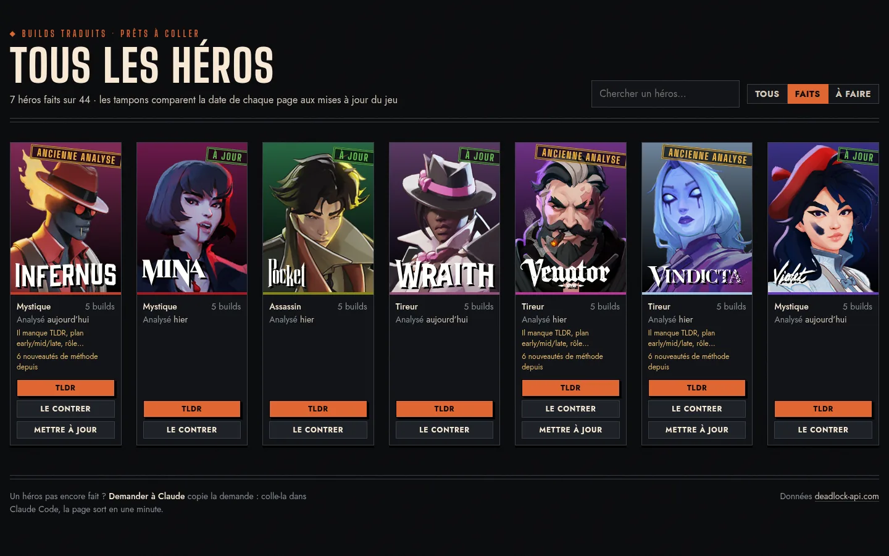
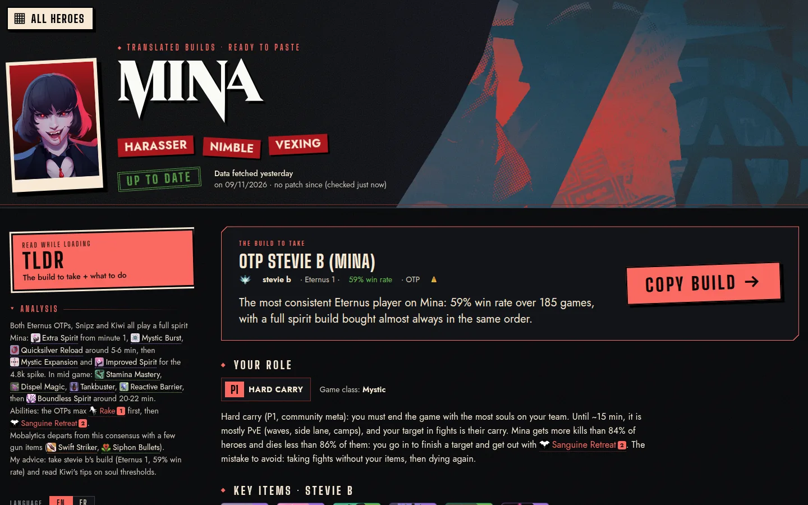
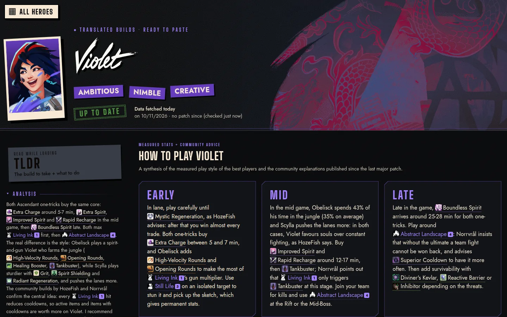
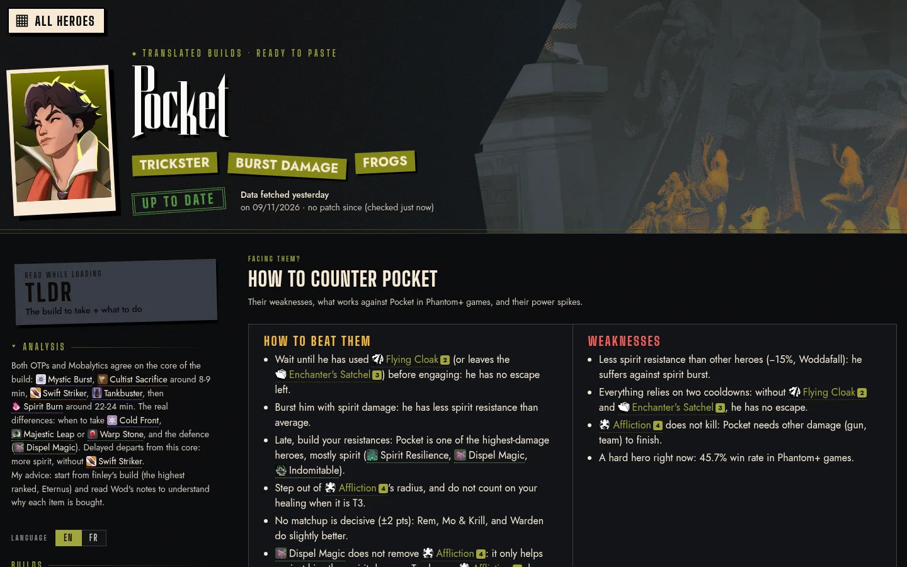

# deadlock-build-fr

A [Claude Code](https://claude.com/claude-code) skill that finds the best **Deadlock** builds for a hero, explains
how to play and counter it, and generates a French web page with build codes you can paste straight into the game.

[](https://github.com/KentoPAC/deadlock-build-fr/actions/workflows/ci.yml)


[](LICENSE)

> Ask Claude *"Trouve-moi les meilleurs builds Mina"* and get a page with a two-minute TLDR, a full guide and
> one-click build codes for the in-game **"Coller le build"** (Paste build) button.

**[Live demo](https://kentopac.github.io/deadlock-build-fr/examples/)**: the home page and seven generated hero pages.

| Home page | TLDR: the build to take and what to do |
| --- | --- |
|  |  |
| **How to play: early / mid / late** | **How to counter: weaknesses, matchups, items** |
|  |  |

## Examples

[`examples/`](examples/) holds pages generated by the skill, published as the
[live demo](https://kentopac.github.io/deadlock-build-fr/examples/): the home page and hero pages such as
[Mina](https://kentopac.github.io/deadlock-build-fr/examples/search-mina/),
[Pocket](https://kentopac.github.io/deadlock-build-fr/examples/search-pocket/) or
[Violette](https://kentopac.github.io/deadlock-build-fr/examples/search-violette/). Build codes in them use author id 0: no personal data.

To refresh them after regenerating your own pages:

```sh
cp ../../../builds/index.html examples/ && for d in ../../../builds/search-*; do cp "$d/index.html" "examples/${d##*/}/"; done
```

## Why

Win-rate tables tell you *what* people buy, never *why*. This skill starts from strong players instead:

- **One-tricks**: high-ranked players (Phantom+) who mostly play the hero. Their build is rebuilt from their real
  purchases: which items, at what minute, in what share of their games, and their ability order.
- **Mobalytics**: the latest build from the official expert accounts, as published in game.
- **Community**: popular public builds with real explanations, written by high-ranked authors.

Each build is then explained early / mid / late, cross-checked with measured statistics, and every written
sentence keeps track of its sources.

## Features

- **Build codes for the game.** Builds are translated to French and encoded in the game's clipboard format
  (`base64(zstd(protobuf CMsgHeroBuild))`), with category sizes recomputed so translated text is not cut.
- **How to play.** Measured play style (souls per minute, lane / jungle / fight share, K/D/A) against the Phantom+
  average, community meta position (1 to 6), ability guide, power spikes placed on the game's level thresholds.
- **How to counter.** Matchups normalised against the expected result, late-game counter items measured from
  matches, counterplay by enemy composition, and creator video tips with timestamped links.
- **Always current.** Item names, icons, tooltips, hero art and patches are re-read from the API on every run;
  nothing about items is hard-coded. Pages compare their own data with the latest patches, live.
- **Sourced and versioned.** Every written text cites its sources, and the analysis method is versioned: when the
  method changes, older pages list exactly what changed and offer a targeted update request.
- **No dependencies.** Python standard library only (3.14+ for the built-in `compression.zstd`).

## Install

The skill lives in a project's `.claude/skills/` folder; generated pages go to the project's `builds/` folder.

```sh
cd my-deadlock-project
git clone https://github.com/KentoPAC/deadlock-build-fr.git .claude/skills/deadlock-build-fr
```

Requirements: Python 3.14+, `wl-copy` (Wayland) or `xclip` (X11) to copy codes, and optionally
[`yt-dlp`](https://github.com/yt-dlp/yt-dlp) to import creator videos.

## Usage

Talk to Claude Code in the project:

| You say | What happens |
| --- | --- |
| *Trouve-moi les meilleurs builds Pocket* | Finds candidates, writes the analysis, opens `builds/search-pocket/index.html` |
| *Comment contrer Vindicta ?* | Same page, opened on the counter view |
| *Traduis ce build : deadchaps.gg/builds/123456* | Translates one build and copies its code |
| *Ouvre la page de tous les héros* | `builds/index.html`: every hero and the state of its page |

The scripts can also be run directly:

```sh
S=.claude/skills/deadlock-build-fr
python3 -I $S/scripts/find.py mina builds/search-mina      # candidates + analysis data
python3 -I $S/scripts/report.py builds/search-mina         # regenerate the page
python3 -I $S/scripts/fetch.py 123456 builds/123456        # one build, texts to translate
python3 -I $S/scripts/codec.py --decode "$(wl-paste -n)"   # inspect a code copied in game
```

## Project layout

```
SKILL.md            instructions Claude follows (workflow, writing rules, sources)
scripts/
  find.py           build candidates (one-tricks, Mobalytics, community)
  fetch.py          one build by id or URL
  apply.py          translations -> build code (+ category layout, clipboard)
  finish.py         one call: translations + analysis -> codes + page
  report.py         hero page assembly
  hub.py            home page with every hero
  playstyle.py      measured play style vs the Phantom+ average
  guides.py         community guides (in-game builds, Steam guides)
  roles.py          game class, meta position, statistical profile
  matchups.py       matchups and items that beat the hero
  counterplay.py    counter items by enemy composition
  counters.py       items one-tricks buy against specific heroes (background)
  videos.py         creator video tips (YouTube subtitles)
  codec.py          build code encoder / decoder
  tooltips.py       in-game style item and ability tooltips
  textlinks.py      links in written texts, shortened-name check
  status.py         method version, completeness, sources
  i18n.py           localized strings (t, table, pattern)
  common.py         API access and shared helpers
locales/            interface strings, one file per language (en, fr)
templates/          hero page and home page (HTML, CSS, JS)
examples/           sample generated pages
assets/             banner and emblem
data/
  changelog.json    analysis method versions
  videos.json       creator video tips
tests/              unit tests (no network)
```

## Languages

Every page is generated in **English** (`index.html`, the default) and **French** (`index.fr.html`), with an
**EN | FR** switch that keeps the current view:

- every interface string (templates and scripts) lives in `locales/<lang>.json` and is read through
  `scripts/i18n.py` (`t`, `table`, `pattern`) or the page's `L()` helper; a new language is a new locale file
  plus an entry in `i18n.LANGS`;
- item, ability and hero names come from the API in the page language;
- the written analysis exists in both languages (`summaries.json` in French, `summaries.en.json` in English, same
  text paths and shared sources), creator tips carry their English text, and every build has a code per language
  (`code.txt`, `code.en.txt`): English authors' words and generated OTP notes need no translation;
- content that is not translated yet is shown in its original language with a notice.

## Development

```sh
./check.sh   # ruff (when installed) + unit tests
```

See [CONTRIBUTING.md](CONTRIBUTING.md) for branch and commit conventions.

## Data and credits

- Match statistics, builds and game assets: [deadlock-api.com](https://deadlock-api.com).
- Community guides: [Steam Community](https://steamcommunity.com/app/1422450/guides/).
- Creator tips: credited and linked on each page (e.g. AndrewChicken).

Deadlock is a trademark of Valve Corporation. This project is not affiliated with or endorsed by Valve.

## License

[MIT](LICENSE)
